# Santosh Shinde

  

AI Lead Engineer in Pune.

I work on problems where a system can look fine and still be wrong: retrieval that misses the right context, evaluations typed in by hand, and data quality issues that hide between Silver and Gold. I would rather show a repo you can run than list skills.

[LinkedIn](https://www.linkedin.com/in/shindesantosh/) · [Medium](https://medium.com/@santosh-shinde) · [AI That Ships (Substack)](https://santosh0.substack.com/) · [X](https://x.com/sanshinde2012) · [Website](https://www.santoshshinde.com/)

## What I build

- Retrieval and evaluation that can be rerun, not just described. [ask-santosh](https://github.com/santoshshinde2012/ask-santosh) measures recall and MRR in CI and publishes the latest scores.
- Lakehouse quality problems as executable examples, with a write-up next to the code. [local-data-lakehouse](https://github.com/santoshshinde2012/local-data-lakehouse) and the Silver and Gold repair repos below are the working copies.
- Applied ML with the limits written down. [crop-disease-prediction](https://github.com/santoshshinde2012/crop-disease-prediction) ships a [model card](https://github.com/santoshshinde2012/crop-disease-prediction/blob/main/MODEL_CARD.md) that states where the reported accuracy stops being a useful number.
- Small tools I can run locally, with a demo when there is one: [holdmap](https://santoshshinde2012.github.io/holdmap/), [Catalogfore](https://santoshshinde2012.github.io/Catalogfore/), and [deck-smith-local](https://github.com/santoshshinde2012/deck-smith-local).

## How I navigate the work

Not every problem lives in the same place. I map what I build to the [Cynefin](https://en.wikipedia.org/wiki/Cynefin_framework) domains, because the right approach for a known CRUD API is the wrong approach for a non-deterministic agent.

  

## Selected work

Each row is a problem, a repo, and a piece of evidence you can open.

| Project | Problem it takes on | Proof |
| --- | --- | --- |
| [ask-santosh](https://github.com/santoshshinde2012/ask-santosh) | A skills list does not prove that retrieval works over a real corpus. | [Retrieval tests](https://github.com/santoshshinde2012/ask-santosh/blob/main/evals/test_retrieval.py) run in CI. Latest published scores: [metrics](https://raw.githubusercontent.com/santoshshinde2012/ask-santosh/gh-pages/metrics/summary.json) · [live demo](https://santoshshinde2012.github.io/ask-santosh/)     |
| [ai-ml-ground-truth](https://github.com/santoshshinde2012/ai-ml-ground-truth) | It is hard to learn AI and ML as a working developer without labs you can actually run. | [Live book](https://santoshshinde2012.github.io/ai-ml-ground-truth/) with interactive explanations and Python labs. Archived at [DOI 10.5281/zenodo.23815936](https://doi.org/10.5281/zenodo.23815936). |
| [crop-disease-prediction](https://github.com/santoshshinde2012/crop-disease-prediction) | A leaf-image classifier is easy to over-claim if the number comes from a friendly dataset split. | The [model card](https://github.com/santoshshinde2012/crop-disease-prediction/blob/main/MODEL_CARD.md) reports 97.83% validation accuracy on a held-out PlantVillage split, and explains why that number will not hold on messy field photos. The repo includes Streamlit, FastAPI, a WhatsApp path, and a React Native TFLite path, with screenshots. |
| [local-data-lakehouse](https://github.com/santoshshinde2012/local-data-lakehouse) | Lakehouse architecture is often read about and rarely started on a laptop. | Runnable local stack (Iceberg, REST catalog, DuckDB, Spark, Trino) plus the article [Stop Reading About Lakehouses. Build One Locally](https://blog.dataengineerthings.org/stop-reading-about-lakehouses-build-one-locally-10e920e3a673). |
| [deck-smith-local](https://github.com/santoshshinde2012/deck-smith-local) | Business decks built from governed data need a trace back to reviewed SQL, not a one-off slide export. | Local agent that builds an editable PowerPoint from a plain-English request, with [bootstrap evidence](https://github.com/santoshshinde2012/deck-smith-local/blob/main/docs/evidence/instabox-bootstrap.gif) and CI including e2e and supply-chain checks. |
| [churn-vs-risk-poc](https://github.com/santoshshinde2012/churn-vs-risk-poc) | A churn score is often treated as a risk score, and the two problems are not the same. | Repo plus [Why Your Churn Model Is Not a Risk Model](https://medium.com/ai-that-ships/why-your-churn-model-is-not-a-risk-model-and-why-it-matters-963e1f9bd2e9). |
| [retention-radar](https://github.com/santoshshinde2012/retention-radar) | A renewal queue needs a score, an explanation, and a way to check whether the action helped. | Calibrated model with SHAP and a holdout, plus [Building a Churn Risk Queue](https://medium.com/data-science-collective/building-a-churn-risk-queue-for-an-ai-platforms-customer-success-team-1414ad462627) and a [UI screenshot](https://github.com/santoshshinde2012/retention-radar/blob/main/docs/img/radar-ui-decision.png). |
| [silver-to-gold-totals](https://github.com/santoshshinde2012/silver-to-gold-totals) | When one Silver row changes, it is unclear which Gold totals must change, and whether a repair matches a full rebuild. | Executable Delta Lake example with a [result snapshot](https://github.com/santoshshinde2012/silver-to-gold-totals/blob/main/docs/results/snapshot.png) and [HTML report](https://github.com/santoshshinde2012/silver-to-gold-totals/blob/main/docs/results/index.html). Companion to [One Silver Row Changed. Which Gold Totals Must Change?](https://blog.dataengineerthings.org/one-silver-row-changed-which-gold-totals-must-change-3430ba3db6f3). |
| [holdmap](https://github.com/santoshshinde2012/holdmap) | It is easy to stop the wrong process when many agents and tools are holding ports. | [Live demo](https://santoshshinde2012.github.io/holdmap/) of a CLI, TUI, desktop app, and MCP server, with screenshots in the repo. |
| [Catalogfore](https://github.com/santoshshinde2012/Catalogfore) | Databricks cost plans are hard to inspect if the rates and assumptions are hidden. | Independent, browser-local [planner](https://santoshshinde2012.github.io/Catalogfore/), with a [screenshot](https://github.com/santoshshinde2012/Catalogfore/blob/main/docs/screenshots/forecast-light.png) and rate evidence in the docs. This is a personal open-source project, not an official calculator. |
| [node-boilerplate](https://github.com/santoshshinde2012/node-boilerplate) | A TypeScript service starter has to stay current, not just look complete on day one. | Created March 2021 and still maintained (last push May 2026), with CI for CodeQL, Snyk, and njsscan. |

## What I have been shipping

<!-- AI-SUMMARY:START -->
- **[nestjs-mindmaps](https://github.com/santoshshinde2012/nestjs-mindmaps)** — Add GitHub Sponsors username to FUNDING.yml _(+2 more)_
- **[multi-agent-sales-ops-tpch-databricks](https://github.com/santoshshinde2012/multi-agent-sales-ops-tpch-databricks)** — Add GitHub Sponsors username to FUNDING.yml _(+2 more)_
- **[gold-rule-to-silver](https://github.com/santoshshinde2012/gold-rule-to-silver)** — Refactor shared Silver reporting and add verified result documentation _(+4 more)_
- **[festive-offer-engine](https://github.com/santoshshinde2012/festive-offer-engine)** — Link the published Databricks system-design article _(+5 more)_
- **[docusaurus-tailwindcss-v4](https://github.com/santoshshinde2012/docusaurus-tailwindcss-v4)** — Add GitHub Sponsors username to FUNDING.yml _(+2 more)_

Built from my last 21 days of public GitHub activity · [workflow](.github/workflows/ai-summary.yml) · updated Nov 23, 2026
<!-- AI-SUMMARY:END -->

## Writing

I write at [Medium](https://medium.com/@santosh-shinde) and in the [AI That Ships](https://medium.com/ai-that-ships) publication, and I publish the same weekly short pieces on [Substack](https://santosh0.substack.com/). The list below is filled by a scheduled workflow.

<!-- BLOG-POST-LIST:START -->
- [How I Measure the Quality of an Agent Skill](https://levelup.gitconnected.com/how-i-measure-the-quality-of-an-agent-skill-544581564597)
- [A Knowledge Graph Is Not a Knowledge Base: How I Navigate One for AI Agents](https://medium.com/ai-that-ships/a-knowledge-graph-is-not-a-knowledge-base-how-i-navigate-one-for-ai-agents-224c1643a3df)
- [The Beginner’s Path to Data Engineering on Databricks](https://medium.com/ai-that-ships/the-beginners-path-to-data-engineering-on-databricks-c437da4f36d0)
- [One Silver Row Changed. Which Gold Totals Must Change?](https://blog.dataengineerthings.org/one-silver-row-changed-which-gold-totals-must-change-3430ba3db6f3)
- [Why Does Every Gold Table Clean the Same Rows?](https://levelup.gitconnected.com/why-does-every-gold-table-clean-the-same-rows-81442cab6f49)
- [Can You Rebuild Silver Without Reloading the Source?](https://medium.com/data-science-collective/can-you-rebuild-silver-without-reloading-the-source-61d1ae4f00a1)
- [Silver Already Keeps History. Why Is Gold Building It Again?](https://blog.dataengineerthings.org/silver-already-keeps-history-why-is-gold-building-it-again-449a8c21a49d)
- [Bronze Loaded the New Schema. Silver Lost a Column](https://levelup.gitconnected.com/bronze-loaded-the-new-schema-silver-lost-a-column-38ec7529ca61)
<!-- BLOG-POST-LIST:END -->

## Contact

[LinkedIn](https://www.linkedin.com/in/shindesantosh/) · [X @sanshinde2012](https://x.com/sanshinde2012) · [Substack](https://santosh0.substack.com/) · [Medium](https://medium.com/@santosh-shinde) · [santoshshinde.com](https://www.santoshshinde.com/)

